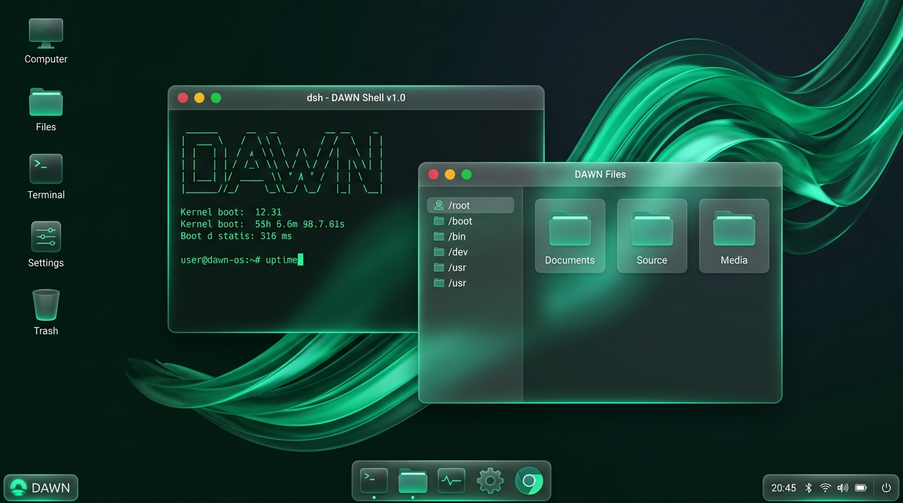
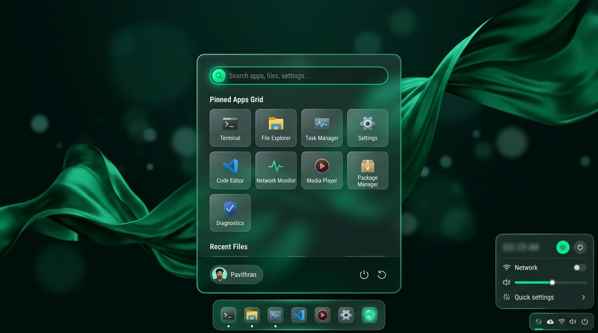

# DAWN-OS

DAWN-OS is an experimental, freestanding x86_64 operating-system project with a server-first direction. Its long-term goals are reliable boot and recovery, low request latency, high sustained concurrency, and efficient CPU and memory use. These are goals, not measured results.

## Visual identity & desktop environment

DAWN-OS features an **Emerald Green Neo-Liquid Glass** design system. The user interface combines translucent frosted-glass panels, dark mode depth, fluid emerald accents, responsive typography, and refractive lighting.

### 1. Login & Lock Screen
Frosted glass credential card with dynamic biometric and password authentication, administrator avatar, integrated status bar, and bottom-right power controls.

<p align="center">
  
</p>

### 2. Main Desktop Workspace
Multi-window glass workspace hosting the DAWN Terminal (`dsh`) with kernel diagnostics, File Explorer with breadcrumb navigation, desktop icons, and fluid emerald backdrop.

<p align="center">
  
</p>

### 3. Apps Bar & Start Menu
Floating frosted-glass application launcher with instant search, pinned application grid (Terminal, Files, Task Manager, Settings, Code Editor, Network Monitor, Media, Diagnostics), user profile pill, and bottom dock with system tray.

<p align="center">
  
</p>

## Current implementation snapshot & test baseline (2026-11-20)

DAWN-OS is an experimental, freestanding x86_64 hobby kernel tested in QEMU under both legacy SeaBIOS and OVMF UEFI firmware. The kernel compiles with strict flags (`-Wall -Wextra -Werror -Wconversion -Wshadow -Wundef`) and passes an extensive in-kernel self-test suite (65+ assertions) across all core subsystems on both BIOS and UEFI.

### Verified features (QEMU BIOS + UEFI)

- **Boot & memory**: Limine v12.10.0 protocol (base revision 6, 4-level paging), physical page frame allocation, HHDM mappings, four-level page tables, and isolated process address spaces.
- **Interrupts & timers**: IDT exception/interrupt handling, PIC remapping, ACPI MADT parsing, IOAPIC-routed PIT delivery, Local APIC timer calibration (100 Hz), and one-shot/periodic delivery.
- **SMP multi-core bootstrap**: Limine SMP protocol, multi-core detection, per-CPU state structures (`struct cpu_core`), Application Processor (AP) bootstrap with dedicated 16 KiB kernel stacks, heartbeat tracking, and dynamic online core synchronization (tested with QEMU `-smp 2`).
- **Scheduler & processes**: Preemptive single-CPU scheduler with timer-driven preemption, round-robin dispatch, kernel stack guards, process-bound context switching (CR3/TSS), CPL3 userspace execution, explicit waiting flag, `SCHEDULER_WAIT_ANY_CHILD` (`-1LL`), and a 1000-cycle spawn/wait/exit stress test with zero resource leaks.
- **Syscall ABI**: System V AMD64 userspace ABI (`argc`, `argv`, `envp`), with `EXIT`, `WRITE`, `READ`, `CLOSE`, `DUP`, `SPAWN`, `EXEC`, `WAIT`, `YIELD`, and `GETPID`.
- **Filesystem**: VFS mount architecture, root RAMFS, and FAT32 read/write driver with BPB geometry validation, directory traversal, file/dir creation, 8.3 short names, cluster boundary writes, multi-cluster extension across FAT0/FAT1, truncation down to partial cluster & zero, cluster reuse after deletion, and simulated interrupted write / out-of-space error recovery verifying FAT consistency and EOC preservation without corruption.
- **Networking**: Real VirtIO-Net PCI driver (`kernel/virtio_net.c`) with VirtQueue RX/TX rings, physical page DMA buffers, MAC auto-negotiation, ARP request/reply resolution, and ICMP echo ping against QEMU user networking (`10.0.2.2`). Software reflection fallback removed from `eth0`.
- **Security**: Standard NIST SHA-256, RFC 6070 PBKDF2-HMAC-SHA256 (10,000 iterations), constant-time password verification (`security_verify_password`), dynamic per-user salt generation using RDRAND with TSC/RTC entropy mixing fallback, and hardcoded root credentials completely removed from production builds.
- **GUI & desktop**: Emerald Green Neo-Liquid Glass desktop environment at 1280x800 resolution with synchronized backbuffer, full-width high-contrast taskbar with neon emerald specular top accent line (`GFX_COLOR_EMERALD_ACCENT`), dedicated frosted-glass System Tray container pill with crisp clock text, and window compositor alpha-blending with transparent terminal text backgrounds (eliminating dark rectangle artifacts).

### Known limitations & non-goals

- **SMP scheduling**: While multi-core AP discovery, bootstrap, and per-CPU state structures are active, the userspace thread scheduler currently dispatches threads primarily on the Bootstrap Processor (BSP); multi-queue per-CPU work-stealing scheduling is future work.
- **Virtual machine tested only**: Automated CI and local development run under QEMU (`-M q35 -m 256M -smp 2 -vga std -device virtio-net-pci`); no testing has been performed on physical bare-metal hardware.
- **USB xHCI**: Register BAR mapping and TRB ring structures are defined and parsed in `kernel/xhci.c`, but live device enumeration (Enable Slot, Address Device, GET_DESCRIPTOR, and live control/interrupt transfers) is not implemented. Live input relies on the 8042 PS/2 keyboard/mouse controller.
- **Audio**: PCI audio discovery and multi-stream PCM software mixer/tone generator exist in `kernel/audio.c`, but live hardware output to AC97 or Intel HD Audio controllers is untested.
- **Networking hardware**: Networking is limited to the VirtIO-Net PCI driver and loopback (`lo`). Bare-metal physical NIC drivers (e.g., Intel e1000, Realtek 8139/8169) are not implemented.
- **No system web browser**: Desktop hyperlinks validate URLs and trigger desktop notification toasts; no HTML engine or browser exists.

### Feature status matrix

| Subsystem / Feature | Status | Notes / Verification |
| :--- | :--- | :--- |
| **Limine Boot Protocol (v12.10.0)** | Tested in QEMU | Base rev 6, 4-level paging, hybrid ISO boots on BIOS & UEFI |
| **Physical Page Allocator (PMM)** | Tested in QEMU | Bitmap frame allocation, boundary checks, free accounting |
| **Virtual Memory Manager (VMM)** | Tested in QEMU | Four-level paging, HHDM, map/translate/unmap, NX/user bits |
| **Isolated Process Address Spaces** | Tested in QEMU | Distinct CR3 per process, user memory teardown |
| **Interrupts & IDT** | Tested in QEMU | 256 vectors, CPU exception handlers, PIC remapping |
| **ACPI & APIC/IOAPIC** | Tested in QEMU | MADT discovery, PIT IRQ override, Local APIC timer (100 Hz) |
| **Single-CPU Preemptive Scheduler** | Tested in QEMU | Timer preemption, round-robin, stack guards, 1000-cycle stress test |
| **Process Lifecycle & Waiting** | Tested in QEMU | Explicit wait flag, `SCHEDULER_WAIT_ANY_CHILD` (`-1LL`), spawn/reap |
| **Syscall Interface (10 calls)** | Tested in QEMU | `EXIT`, `WRITE`, `READ`, `CLOSE`, `DUP`, `SPAWN`, `EXEC`, `WAIT`, `YIELD`, `GETPID` |
| **CPL3 Userspace Execution** | Tested in QEMU | System V AMD64 ABI, IRETQ frame, user stack isolation |
| **ELF64 Executable Loader** | Tested in QEMU | In-memory ELF image parsing, segment mapping, process launch |
| **Virtual Filesystem (VFS)** | Tested in QEMU | Mount points, root RAMFS, path resolution, dentry cache |
| **FAT32 Filesystem** | Tested in QEMU | Cluster boundary writes, multi-cluster extension, truncate, reuse, out-of-space consistency |
| **VirtIO-Net PCI Network Driver** | Tested in QEMU | VirtQueue RX/TX, DMA rings, ARP resolution, ICMP ping to 10.0.2.2 |
| **Cryptographic Security Hardening**| Tested in QEMU | NIST SHA-256, RFC 6070 PBKDF2 (10,000 iter), RDRAND salt, constant-time compare |
| **Desktop Environment & Compositor**| Tested in QEMU | 1280x800 resolution, neon taskbar, system tray pill, transparent terminal text |
| **PS/2 Keyboard & Mouse Drivers** | Tested in QEMU | 8042 scancode decoding, mouse packet decoding, boundary clipping |
| **Shell (`dsh`) & Terminal Emulator** | Tested in QEMU | 80x25 text grid, ANSI colors, scrolling, history, built-in commands |
| **Graphical Task Manager** | Tested in QEMU | Live process list, CPU usage history graph, RAM gauge |
| **Settings & Metadata Subsystem** | Tested in QEMU | System info, CPUID brand, memory/uptime stats, non-tamperable identity |
| **USB 3.0 / 3.1 xHCI** | Source only | Register BAR mapping & TRB parsing tests only; no device I/O or enumeration |
| **USB HID Class Driver** | Source only | Boot keyboard/mouse report parsing structs present; no live USB transfer stream |
| **SATA / AHCI 1.3 Driver** | Source only | FIS command packing & PRDT descriptors tested; no live disk I/O in test ISO |
| **NVM Express (NVMe 1.3/1.4)** | Source only | SQE/CQE layout & doorbell calculation tested; no live controller in test ISO |
| **ISO9660 Filesystem** | Source only | PVD & directory extent parsing present in source |
| **Audio Subsystem & Mixer** | Source only | PCI discovery & software PCM mixer/tone generator tested in memory; no live audio output |
| **Symmetric Multiprocessing (SMP)**| Tested in QEMU | Limine SMP protocol, multi-core detection, AP startup with dedicated stacks & online sync |
| **Physical Ethernet Drivers** | Missing | VirtIO-Net PCI only; bare-metal drivers (e1000, rtl8139) not implemented |
| **Web Browser** | Missing | Desktop links show notification toasts; HTML/DOM engine not implemented |

## Build the kernel ELF

Requirements: GNU Make, GCC with x86_64 code-generation support, and GNU binutils (`ld` and `readelf`). From the repository root:

```sh
make clean kernel
make check
file build/dawn-kernel.elf
make kernel-test
```

The build is freestanding: it disables hosted runtime assumptions, PIE/PIC, stack protector, the x86_64 red zone, and SIMD code generation. A Linux-hosted compiler is only a build tool, not a DAWN-OS runtime.

## Build a BIOS/UEFI hybrid ISO

Obtain the Limine v12.10.0 binary package and place its `limine` installer, `limine-bios.sys`, `limine-bios-cd.bin`, `limine-uefi-cd.bin`, and `BOOTX64.EFI` under `limine-binary/` (or set `LIMINE_DIR` to that directory). Install `xorriso`, then run:

```sh
make iso LIMINE_DIR=limine-binary
```

The ISO target creates a hybrid BIOS/UEFI image and installs Limine's BIOS stage. The build does not download or silently replace third-party bootloader binaries.

## Run DAWN-OS in a virtual machine

QEMU is the primary development VM. Install `qemu-system-x86`, `ovmf` (UEFI firmware), and `timeout` in addition to the ISO build requirements.

Run the interactive BIOS VM:

```sh
make run LIMINE_DIR=limine-binary
```

Run automated self-tests under BIOS and UEFI:

```sh
make qemu-test LIMINE_DIR=limine-binary
make qemu-uefi-test LIMINE_DIR=limine-binary OVMF_CODE=/usr/share/OVMF/OVMF_CODE.fd OVMF_VARS=/usr/share/OVMF/OVMF_VARS.fd
```

Or run both with `make qemu-test-all`. The QEMU test uses the `isa-debug-exit` device: exit status 33 means the kernel self-test reported success, 35 means it reported failure. Serial logs are saved under `build/`. UEFI firmware paths vary by distribution; set `OVMF_CODE` and `OVMF_VARS` to a matching OVMF code/variables pair. The test copies the variables image into `build/` before boot so the installed firmware template is not modified.

The resulting ISO can also be attached to VirtualBox or VMware as a virtual optical disk after QEMU validation. Those hypervisors are not yet covered by automated CI.

## Continuous integration

The workflow `.github/workflows/phase-a-boot.yml` runs on pushes to `main` and `bootstrap/**`, pull requests targeting `main`, and manual dispatch. It installs the build/VM tools, downloads the pinned Limine v12.10.0 binary package, builds and checks both kernels, creates a test ISO, and attempts BIOS and UEFI boots in QEMU. It uploads the ISO and serial logs as workflow artifacts.

A green workflow is evidence only for the tests that actually ran in that environment. Review the logs; do not infer physical-hardware compatibility from QEMU success.

## Phase A verification

The latest recorded GitHub Actions run passed kernel compilation, ELF checks, hybrid BIOS/UEFI ISO creation, and QEMU boots under both SeaBIOS and OVMF UEFI. This is VM evidence only; physical BIOS/UEFI systems and Secure Boot are not yet validated.

## Phase B — memory and CPU foundations

The first increment requests, validates, and reports the Limine memory map. See [the memory-map implementation notes](docs/MEMORY_MAP.md). It deliberately does not enable allocation yet.

Remaining Phase B work:
- Harden allocation accounting and add synchronization after interrupt/CPU foundations exist.
- Extend page-table permission/lifetime tests; add address-space ownership and mapping teardown after process and fault-handling foundations.
- Expand APIC/IOAPIC routing and ACPI coverage; the first MADT-discovered ISA PIT IRQ route is implemented and QEMU-tested.
- Extend the cooperative scheduler with timer-driven preemption only after interrupt-frame switching and per-thread interrupt-state tests.
- Add SMP only after CPU startup, per-CPU state, synchronization, and locking are defined.

## Roadmap

1. **Boot and test:** verify Limine boot on QEMU, preserve serial diagnostics, and expand the kernel test harness.
2. **Memory and interrupts:** validate the boot memory map, initialize the physical page allocator and extend virtual-memory support, then extend APIC/IOAPIC routing coverage and add fault recovery.
3. **Execution and SMP:** extend cooperative kernel threads with preemption, then add CPU startup, synchronization, and per-CPU state.
4. **Userspace and storage:** define a syscall ABI and privilege boundary, add a compact runtime and service supervisor, then add filesystem and virtio block I/O.
5. **Networking:** add virtio networking and a documented network stack, then implement a small reproducible HTTP workload.
6. **Measurement and optimization:** establish correctness baselines and measure throughput, p50/p95/p99 latency, CPU time per request, RAM, service-ready time, and failure recovery. Compare with Linux only under equivalent hardware/VM, resource limits, devices, service semantics, workload, configuration, and duration.

No performance or security superiority over Linux is claimed. A small kernel ELF is not directly comparable to a complete Linux distribution.

## Licensing

The project retains the repository's Unlicense dedication. The minimal Limine protocol declarations in `include/limine_requests.h` are derived from the official Limine protocol header and carry its 0BSD license notice.

## Developer identity and OS metadata

DAWN-OS is developed and maintained by **Pavithran** (project owner: **Pavithran26**). The authoritative identity is `config/os_metadata.json`; it is the single source for the website (`https://pavithran26.net`), GitHub profile (`https://github.com/Pavithran26`), repository and issue tracker.

- `tools/generate_metadata.py` validates the JSON and generates `include/dawn_metadata_generated.h`. Dynamic build fields (Git commit, reproducible build date, kernel version) come from the build environment, not from hand-edited UI strings.
- `include/os_metadata.h` / `kernel/os_metadata.c` expose a read-only runtime API with URL validation, optional-field handling, and safe text escaping. Invalid metadata is rejected rather than replaced with invented values.
- Settings now includes **About DAWN-OS**, **Developer Credits**, **Help & Support**, and **System Information** tabs, all powered by that API. The desktop taskbar shows a clickable developer footer.
- System Information reads CPU brand via CPUID, memory from the physical allocator, uptime from the LAPIC timer, and storage/filesystem data from the block and storage managers. Values that cannot be detected display "Not available".

There is no system browser in the current build. Clicking a link validates the URL and shows a notification containing it; opening a real browser is future work. See `docs/OS_METADATA.md` for the schema, validation rules, and update instructions.
