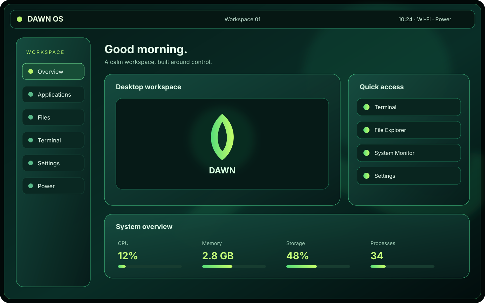
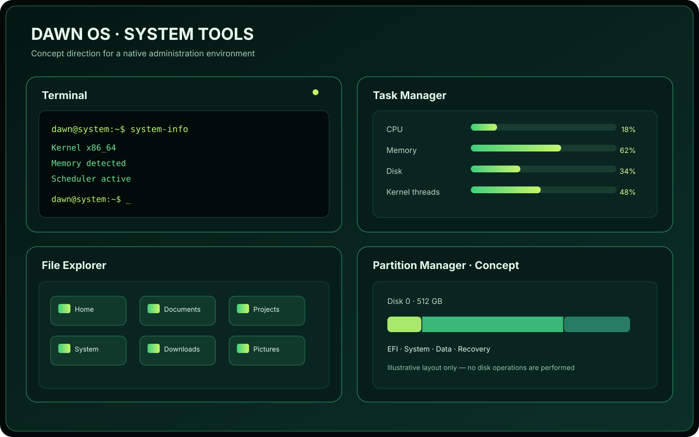

# DAWN-OS

DAWN-OS is an experimental, freestanding x86_64 operating-system project with a server-first direction. Its long-term goals are reliable boot and recovery, low request latency, high sustained concurrency, and efficient CPU and memory use. These are goals, not measured results.

## Visual direction — concept mockups

The following visuals illustrate the intended emerald-green, glass/neomorphic desktop direction. **They are design concepts, not screenshots of a running desktop.** The terminal, file explorer, task manager, and partition manager shown here are planned interface concepts; they are not evidence that those applications are implemented.

<p align="center">
  
</p>

<p align="center">
  
</p>

## Current implementation snapshot (2026-11-18)

DAWN-OS is an actively developed x86_64 kernel, not yet a complete desktop operating system. The repository currently includes:

- Limine BIOS/UEFI boot scaffolding, serial diagnostics, framebuffer request, and a kernel self-test target.
- Physical page allocation, HHDM validation, four-level paging, isolated process address spaces, user-page ownership, and teardown.
- IDT exception/interrupt handling, ACPI MADT discovery, xAPIC/IOAPIC setup, PIT routing, and LAPIC timer support.
- A single-CPU scheduler with guarded kernel stacks, cooperative switching, timer preemption, process-bound contexts, and a controlled CPL3 ELF launch path.
- A bounded userspace ABI with ABI version, serial `WRITE`, `EXIT`, `GETPID`, `YIELD`, blocking `WAIT`, `READ`, `CLOSE`, `DUP`, `SPAWN`, and `EXEC`; exit status is retained in process metadata and published on child collection.
- Process parent identifiers, child metadata lookup, and per-process file descriptor tables with standard I/O streams and inheritance.
- System V AMD64 ABI compliant user argument and environment stack setup (`argc`, `argv`, `envp`), dynamic process spawning, and userspace runtime (`user/include/dawn.h`, `user/crt0.S`, `user/libdawn.c`).
- Native DAWN-OS Init process (PID 1) supervisor architecture and embedded binary generator.
- Virtual Filesystem (VFS) architecture with mount table, unified node operations, and root RAMFS (`/boot`, `/dev`, `/mnt`, `/tmp`, `/bin`).
- FAT32 filesystem driver with BPB validation, cluster allocation/traversal, 8.3 filename encoding, and file read/write.
- ISO9660 filesystem driver with Primary Volume Descriptor (PVD) parsing, directory extent parsing, and file reading.
- VFS directory entry (dentry) cache with LRU replacement and prefix invalidation.
- File explorer backend engine supporting directory enumeration, sorting, recursive search, copy, move, and deletion.
- Block device abstraction with unified read/write/flush operations and built-in RAM disk driver.
- PCI bus scanner (Mechanism 1) with configuration space access and storage controller discovery.
- SATA/AHCI 1.3 controller driver with 48-bit LBA DMA command generation and port detection.
- NVMe 1.3/1.4 controller driver with 64-byte SQE and 16-byte CQE queues, doorbell calculation, and namespace discovery.
- Partition subsystem supporting MBR and GPT parsing, partition creation/deletion, FAT32 formatting, and transparent partition slice block devices with 1 MiB alignment and overlap protection.
- Central Storage Manager providing disk inventory, partition creation, formatting, and automatic filesystem mounting.
- Unified Device Manager and dynamic Driver Framework with resource allocation and device-to-driver binding.
- Dual-channel 8042 PS/2 controller driver with keyboard Scancode Set 1 decoding and 3-byte stream-mode mouse packet decoding.
- USB 3.0 / 3.1 xHCI controller driver with Capability/Operational registers, TRB ring formats, and Root Hub port discovery.
- USB HID boot keyboard and boot mouse class drivers translating HID usage reports to normalized input events.
- Unified input event queue and non-blocking event polling subsystem for keyboard and mouse events.
- Graphics Abstraction Layer (GAL) with software double buffering, integer alpha blending, gradients, glass panels, and 8x16 monospace typography.
- Built-in 16x16 vector/bitmap icon engine for system applications (Terminal, Files, Task Manager, Settings, Computer, Power, DAWN-OS Logo).
- Window Manager and Compositor with Z-order stack management, click-to-focus, titlebar drag-and-drop, and Ruby/Emerald/Amber window control buttons.
- Emerald Green Neo-Liquid Glass Desktop Environment featuring translucent frosted glass panels, bottom Taskbar, Start Menu / App Launcher, desktop icons, and top-right toast notifications.
- Command shell (`dsh`) with quote-aware tokenizer, command history recall, environment variable table, and built-in filesystem, memory, disk, and process commands.
- Graphical Terminal Emulator with 80x25 character grid, ANSI color formatting, line scrolling, blinking cursor, and Window Manager integration.
- Graphical Task Manager with real-time CPU utilization graph, physical RAM gauge, process list with state/memory/CPU metrics, and process termination.
- Network subsystem with loopback (`lo`) and Ethernet (`eth0`) devices, ARP, IPv4, ICMP Ping, UDP, TCP state machine, and BSD-style Socket API.
- Audio subsystem with PCI multimedia discovery, multi-stream PCM software mixer with 16-bit signed clipping, master volume/mute controls, and square wave tone synthesis.
- Central Settings framework with persistent configuration (`/boot/system.cfg`), dynamic hardware reconfiguration, and graphical tabbed Settings application.
- Operating system installer with automated MBR/GPT partitioning, FAT32 formatting, system tree deployment, Limine bootloader installation, and emergency recovery rescue shell.

Security, runtime, services, power, and accessibility are scheduled in subsequent phases. Phases C through M (process, syscalls, VFS, storage, hardware, graphics desktop, terminal, shell, task manager, networking, audio, settings, and installer) are implemented.

**Validation boundary:** recent Phase B/C source increments have not been compiled or exercised in QEMU. Do not infer bootability, hardware compatibility, or runtime correctness from source commits alone. The planned testing phase will cover compilation, kernel self-tests, BIOS/UEFI QEMU boots, and subsystem-specific validation.

## Build the kernel ELF

Requirements: GNU Make, GCC with x86_64 code-generation support, and GNU binutils (`ld` and `readelf`). From the repository root:

```sh
make clean kernel
make check
file build/dawn-kernel.elf
make kernel-test
```

The build is freestanding: it disables hosted runtime assumptions, PIE/PIC, stack protector, the x86_64 red zone, and SIMD code generation. A Linux-hosted compiler is only a build tool, not a DAWN-OS runtime.

## Build a BIOS/UEFI hybrid ISO

Obtain the Limine v12.10.0 binary package and place its `limine` installer, `limine-bios.sys`, `limine-bios-cd.bin`, `limine-uefi-cd.bin`, and `BOOTX64.EFI` under `limine-binary/` (or set `LIMINE_DIR` to that directory). Install `xorriso`, then run:

```sh
make iso LIMINE_DIR=limine-binary
```

The ISO target creates a hybrid BIOS/UEFI image and installs Limine's BIOS stage. The build does not download or silently replace third-party bootloader binaries.

## Run DAWN-OS in a virtual machine

QEMU is the primary development VM. Install `qemu-system-x86`, `ovmf` (UEFI firmware), and `timeout` in addition to the ISO build requirements.

Run the interactive BIOS VM:

```sh
make run LIMINE_DIR=limine-binary
```

Run automated self-tests under BIOS and UEFI:

```sh
make qemu-test LIMINE_DIR=limine-binary
make qemu-uefi-test LIMINE_DIR=limine-binary OVMF_CODE=/usr/share/OVMF/OVMF_CODE.fd OVMF_VARS=/usr/share/OVMF/OVMF_VARS.fd
```

Or run both with `make qemu-test-all`. The QEMU test uses the `isa-debug-exit` device: exit status 33 means the kernel self-test reported success, 35 means it reported failure. Serial logs are saved under `build/`. UEFI firmware paths vary by distribution; set `OVMF_CODE` and `OVMF_VARS` to a matching OVMF code/variables pair. The test copies the variables image into `build/` before boot so the installed firmware template is not modified.

The resulting ISO can also be attached to VirtualBox or VMware as a virtual optical disk after QEMU validation. Those hypervisors are not yet covered by automated CI.

## Continuous integration

The workflow `.github/workflows/phase-a-boot.yml` runs on pushes to `main` and `bootstrap/**`, pull requests targeting `main`, and manual dispatch. It installs the build/VM tools, downloads the pinned Limine v12.10.0 binary package, builds and checks both kernels, creates a test ISO, and attempts BIOS and UEFI boots in QEMU. It uploads the ISO and serial logs as workflow artifacts.

A green workflow is evidence only for the tests that actually ran in that environment. Review the logs; do not infer physical-hardware compatibility from QEMU success.

## Phase A verification

The latest recorded GitHub Actions run passed kernel compilation, ELF checks, hybrid BIOS/UEFI ISO creation, and QEMU boots under both SeaBIOS and OVMF UEFI. This is VM evidence only; physical BIOS/UEFI systems and Secure Boot are not yet validated.

## Phase B — memory and CPU foundations

The first increment requests, validates, and reports the Limine memory map. See [the memory-map implementation notes](docs/MEMORY_MAP.md). It deliberately does not enable allocation yet.

Remaining Phase B work:
- Harden allocation accounting and add synchronization after interrupt/CPU foundations exist.
- Extend page-table permission/lifetime tests; add address-space ownership and mapping teardown after process and fault-handling foundations.
- Expand APIC/IOAPIC routing and ACPI coverage; the first MADT-discovered ISA PIT IRQ route is implemented and QEMU-tested.
- Extend the cooperative scheduler with timer-driven preemption only after interrupt-frame switching and per-thread interrupt-state tests.
- Add SMP only after CPU startup, per-CPU state, synchronization, and locking are defined.

## Roadmap

1. **Boot and test:** verify Limine boot on QEMU, preserve serial diagnostics, and expand the kernel test harness.
2. **Memory and interrupts:** validate the boot memory map, initialize the physical page allocator and extend virtual-memory support, then extend APIC/IOAPIC routing coverage and add fault recovery.
3. **Execution and SMP:** extend cooperative kernel threads with preemption, then add CPU startup, synchronization, and per-CPU state.
4. **Userspace and storage:** define a syscall ABI and privilege boundary, add a compact runtime and service supervisor, then add filesystem and virtio block I/O.
5. **Networking:** add virtio networking and a documented network stack, then implement a small reproducible HTTP workload.
6. **Measurement and optimization:** establish correctness baselines and measure throughput, p50/p95/p99 latency, CPU time per request, RAM, service-ready time, and failure recovery. Compare with Linux only under equivalent hardware/VM, resource limits, devices, service semantics, workload, configuration, and duration.

No performance or security superiority over Linux is claimed. A small kernel ELF is not directly comparable to a complete Linux distribution.

## Licensing

The project retains the repository's Unlicense dedication. The minimal Limine protocol declarations in `include/limine_requests.h` are derived from the official Limine protocol header and carry its 0BSD license notice.
