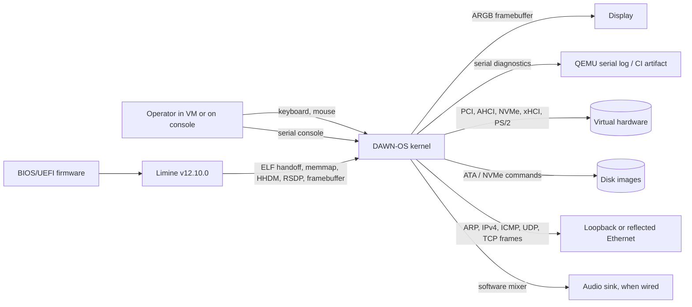
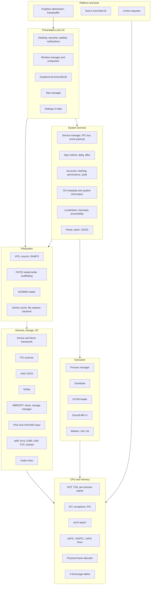
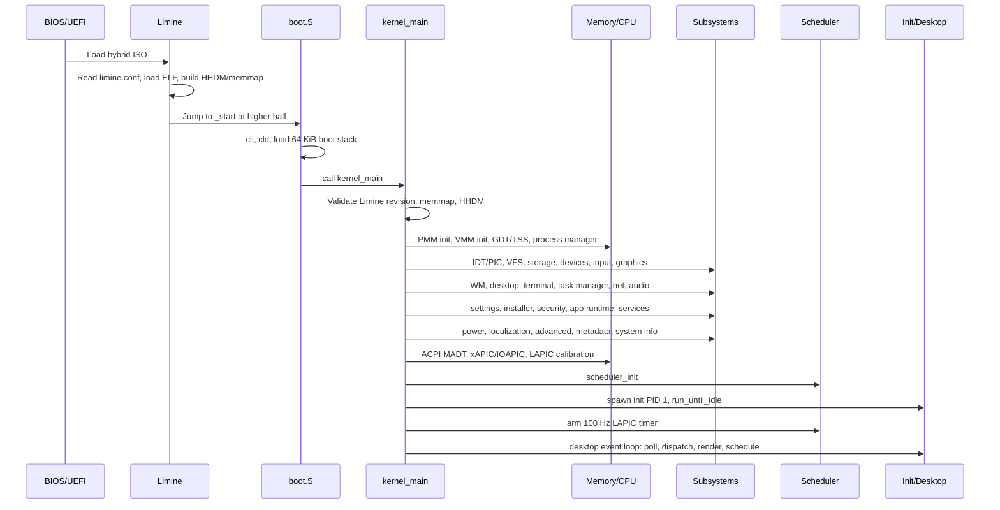
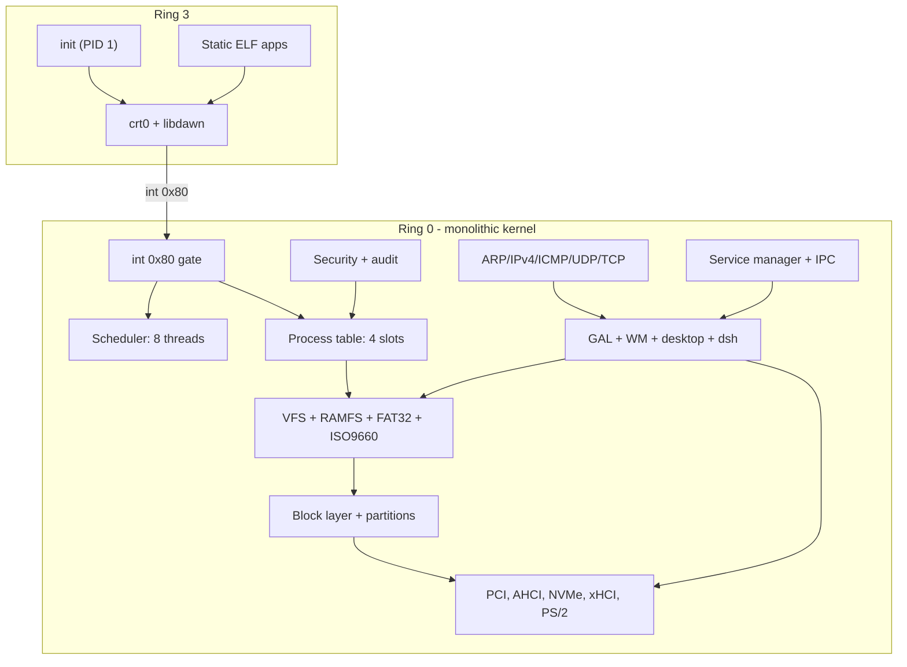
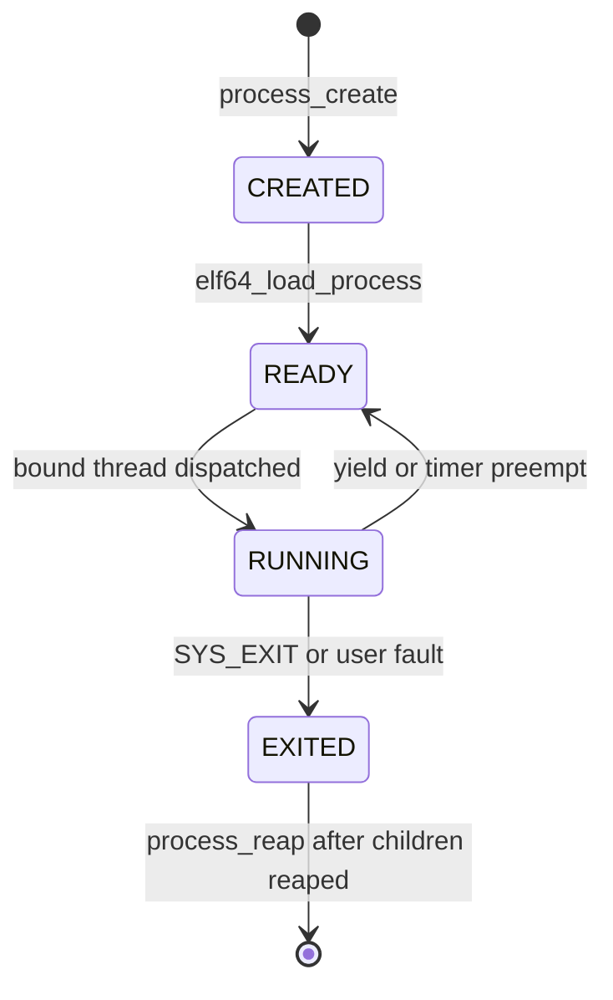
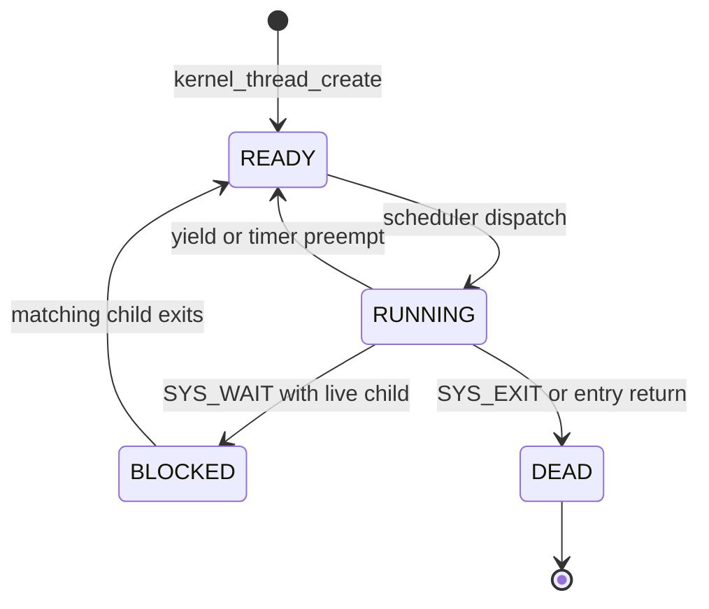
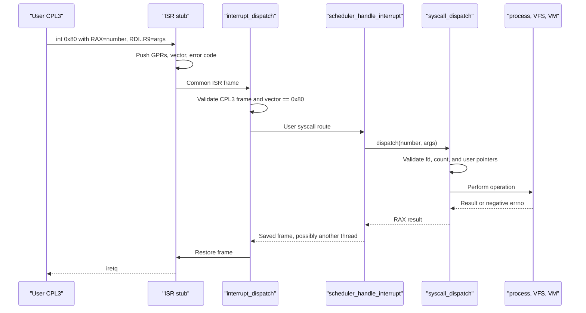
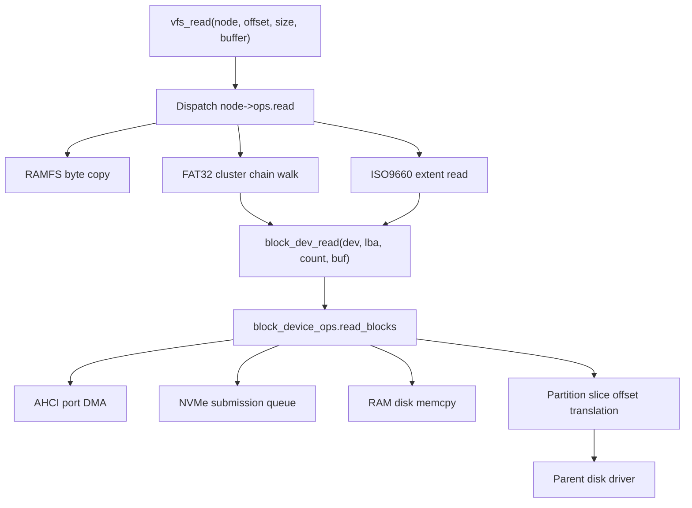
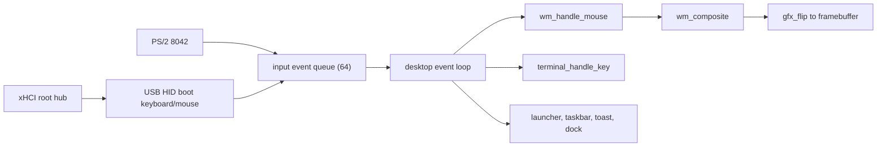
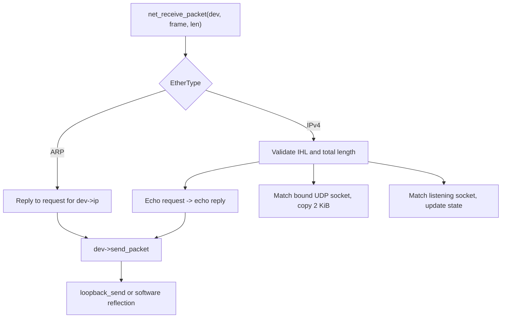

# DAWN-OS Architecture: HLD and LLD

Snapshot date: 2026-11-23
Status: source-derived design document and verified architecture reference. See [Validation boundary](#5-validation-boundary-and-test-strategy).

---

## 1. Tech stack

### 1.1 Languages and toolchain

| Area | Choice |
|---|---|
| Kernel and userspace runtime | C11 (`-std=gnu11`), freestanding |
| Architecture-specific code | x86-64 GNU assembler (AT&T syntax), `.S` files |
| Build system | GNU Make (single top-level `Makefile`) |
| Compiler | GCC with x86-64 code generation |
| Assembler / linker / inspection | GNU binutils: `as`, `ld`, `readelf` |
| Link format | Static `ET_EXEC` ELF64, custom linker script |
| Bootloader | Limine v12.10.0, base protocol revision 6 |
| Firmware targets | Legacy BIOS and UEFI via a hybrid ISO |
| ISO tooling | `xorriso` (`-as mkisofs`, El Torito BIOS + EFI boot) |
| Primary VM | QEMU `q35`, SeaBIOS and OVMF, `isa-debug-exit` |
| CI | GitHub Actions on `ubuntu-24.04` |
| Build-time code generation | Python 3 (`tools/generate_metadata.py`) |
| Runtime dependencies | None: no libc, no POSIX runtime, no external kernel modules |
| License | Unlicense; Limine protocol declarations carry 0BSD |

Key freestanding build flags (`Makefile`):

```text
-std=gnu11 -O2 -Wall -Wextra -Werror -Wconversion -Wshadow -Wundef
-ffreestanding -fno-stack-protector -fno-pic -fno-pie
-fno-asynchronous-unwind-tables -fno-unwind-tables
-m64 -mcmodel=kernel -mno-red-zone -mno-mmx -mno-sse -mno-sse2
-msoft-float -Iinclude
```

Link flags:

```text
-nostdlib -static -no-pie -z max-page-size=0x1000 --build-id=none
```

Implications:

- No hosted C library. `memset`, `memcpy`, `memmove`, and `memcmp` are implemented in the kernel.
- No SSE/MMX and no red zone. Context switches and ISR paths remain integer-only.
- `-mcmodel=kernel` places the kernel in the negative 2 GiB canonical half.
- Compiler warnings are errors. That is why the tree leans heavily on checked arithmetic and explicit casts.

### 1.2 Repository composition

| Path | Contents |
|---|---|
| `arch/x86_64/` | `boot.S`, `gdt.S`, `interrupts.S`, `context_switch.S`, `user_mode.S` |
| `kernel/` | 46 C translation units: boot handoff, memory, interrupts, processes, VFS, drivers, UI, services |
| `include/` | Public kernel interfaces and Limine protocol subset |
| `user/` | Native userspace ABI (`dawn.h`), `crt0.S`, `libdawn.c`, `init.c` |
| `config/os_metadata.json` | Authoritative OS identity metadata |
| `tools/generate_metadata.py` | Validates JSON and generates `include/dawn_metadata_generated.h` |
| `docs/` | Phase status notes, memory/APIC/scheduler design notes, UI plan, this document |
| `limine.conf`, `linker.ld` | Boot entry and link layout |
| `.github/workflows/phase-a-boot.yml` | Build + ISO + QEMU BIOS/UEFI pipeline |

The binary layout is unusually strict. `linker.ld` defines four load segments:

| Segment | Permissions | Contents |
|---|---|---|
| `requests` | RW | Limine request/response block |
| `text` | RX | `.text.boot` and all code |
| `rodata` | R | Constants, fonts |
| `data` | RW | `.data`, `.bss` |

The kernel virtual base is `0xffffffff80000000`. `.limine_requests_start`, `.limine_requests`, and `.limine_requests_end` must remain writable because Limine writes response pointers into them.

### 1.3 Platform target

- x86-64, single CPU only.
- 4-level paging (PML4/PDPT/PD/PT), explicitly requested from Limine.
- Ring 0 kernel and Ring 3 user mode.
- Legacy `int 0x80` syscall gate, not `SYSCALL`/`SYSRET`.
- xAPIC + IOAPIC, Local APIC timer, PIT calibration reference.
- ACPI MADT discovery for BSP APIC ID, IOAPIC, and IRQ overrides.
- PCI mechanism 1, AHCI, NVMe, xHCI, PS/2.
- Limine framebuffer, ARGB8888 software rendering.

### 1.4 Test and CI stack

- `make kernel` builds `build/dawn-kernel.elf`.
- `make kernel-test` builds a second kernel with `-DDAWN_KERNEL_TEST=1`.
- `make user-bins` builds all 28 Ring-3 userspace applications.
- `make iso` packages the hybrid bootable production ISO `build/dawn-os.iso`.
- `make iso-test` packages the hybrid bootable self-test ISO `build/dawn-os-test.iso`.
- `make qemu-test` boots the self-test ISO under SeaBIOS and expects QEMU exit status 33 (64/64 unit tests pass).
- `make qemu-uefi-test` boots the self-test ISO under OVMF and expects the same status (64/64 unit tests pass).
- `make qemu-smoke-bios` boots the production ISO under SeaBIOS and verifies clean boot into the desktop compositor event loop.
- `make qemu-smoke-uefi` boots the production ISO under OVMF and verifies clean boot into the desktop compositor event loop.
- `make qemu-smoke-all` executes both production ISO smoke tests.
- Exit status 35 means a kernel self-test failed.
- CI pipeline (`.github/workflows/phase-a-boot.yml`) verifies Limine v12.10.0, compiles with `-Werror`, executes both unit tests and production smoke tests, and publishes all verified binaries and ISOs to 7 dedicated Git branches (`qemu`, `qemu-bios`, `qemu-uefi`, `kernel`, `kernel-test`, `userland`, `test-results`).

### 1.5 Runtime constraints that shape the design

1. **No kernel heap.** Subsystems use static pools and fixed-capacity arrays.
2. **Single CPU scheduling.** Multi-core SMP bootstrap and AP initialization are active, while the scheduler core currently dispatches on BSP.
3. **No demand paging, COW, swap, or file-backed page cache.**
4. **Bounded concurrency:** 4 processes, 8 kernel threads, 16 FDs per process.
5. **Polling UI input.** `input_poll_hardware()` is called from the desktop loop.
6. **No userspace GUI toolkit.** Desktop components are linked into the kernel.
7. **Hardware Driver Status:** VirtIO-Net PCI NIC driver (real packets, ARP, ICMP ping) and VirtIO-Block PCI driver (VirtIO 0.9.5 Legacy Transport via I/O BAR registers, PCI Device ID 0x1001 only, VirtQueue 0 DMA, capacity discovery, chunked 512-byte sector reads, read-only enforcement, live device-backed ISO9660 mount, and userspace CPL3 file access) are fully implemented and verified under QEMU. Audio is in-kernel software synthesis (no physical HDA codec driver yet), and AHCI/NVMe drivers perform discovery and virtual block transfers without physical DMA command issue.

---

## 2. High-level design (HLD)

### 2.1 Goals and non-goals

**Stated goals**

- Reliable boot and recovery.
- Low request latency and high sustained concurrency.
- Efficient CPU and memory use.
- Server-first direction.
- A local graphical administration shell that is optional, never required for boot or services.

**Non-goals in the current implementation**

- POSIX compatibility.
- Multi-user preemptive timesharing at scale.
- SMP scalability.
- Linux binary compatibility.
- Claimed performance or security superiority over Linux.

The README explicitly frames latency, concurrency, and efficiency as goals, not measured results.

### 2.2 System context



### 2.3 Layered architecture



The dominant architectural fact: **the desktop and its "applications" live in Ring 0**, while a small Ring 3 path exists for ELF programs. This differs from `docs/GUI_SHELL_PLAN.md`, which says UI should be userspace. That plan is the intended direction; the current code is monolithic.

### 2.4 Component catalog

| Layer | Component | Responsibility | Source-level state |
|---|---|---|---|
| Boot | Limine requests, `boot.S` | Handoff, stack, entry | Implemented |
| CPU | GDT/TSS, IDT, ACPI, APIC | Protection, traps, timers | Implemented |
| Memory | PMM, VMM | 4 KiB frames, address spaces, W^X | Implemented |
| Execution | Scheduler | 8 kernel threads, round-robin, timer preemption | Implemented |
| Execution | Process manager | 4 isolated address spaces, FDs, parent/child | Implemented |
| Execution | Syscall ABI | 11 calls over `int 0x80` | Implemented |
| Execution | ELF loader | Static ET_EXEC, PT_LOAD, user stack | Implemented |
| Execution | Userspace | `dawn.h`, `crt0.S`, `libdawn.c`, `init.c` | Implemented |
| FS | VFS + RAMFS | Mounts, path resolution, node ops | Implemented |
| FS | FAT32 | BPB validation, 8.3 names, cluster chains | Read-only boundary documented |
| FS | ISO9660 | PVD and extent reads | Implemented reader |
| FS | Dentry cache | 32-entry LRU + prefix invalidation | Implemented |
| Storage | Block layer | 32 block devices, read/write/flush | Implemented |
| Storage | PCI/AHCI/NVMe | Discovery and command scaffolding | Partial |
| Storage | MBR/GPT + storage manager | 8 disks x 8 partitions, automount | Implemented |
| Devices | Device/driver registry | 64 devices, 32 drivers | Implemented |
| Input | PS/2, xHCI, USB HID | Normalized key/mouse events | Implemented |
| UI | GAL | Double buffer, alpha, gradients, font, icons | Implemented |
| UI | WM/compositor | 16 windows, Z-order, focus, drag, controls | Implemented |
| UI | Desktop | Launcher, taskbar, notifications | Implemented |
| UI | Terminal/shell | 80x25, ANSI colors, `dsh` | Implemented |
| UI | Task manager, settings | Process and memory views, 10 tabs | Implemented |
| Net | ARP/IPv4/ICMP/UDP/TCP | Protocol parsing and socket API | Scaffolding |
| Audio | PCM mixer | 4 streams, volume/mute, tone | Scaffolding |
| Security | Accounts/hash/audit | 16 users, 32 audit records | Implemented in-memory |
| Services | Service manager/IPC/events | 16 units, 32-message queue | In-memory registry |
| Apps | dpkg/dlibc/app lifecycle | 16 packages, 64 KiB heap | In-memory registry |
| Power | Reboot/shutdown/panic | Port-based reset, GSOD | Implemented |
| Installer | Staged install/recovery | 9 stages, rescue shell | Scaffolding |
| Localization | 5 locales, 5 keymaps | Strings and accessibility | Implemented |
| Advanced | Locks, shm, mmap, modules | 8 shm, 16 mmap, 8 modules | Implemented |
| Meta | JSON to generated header | Identity, credits, links | Implemented |

### 2.5 Boot and initialization sequence



Ordered initialization, as wired in `kernel/main.c`:

1. Validate Limine base revision, memory map, and HHDM offset.
2. Physical frame allocator from usable memory.
3. Virtual-memory manager attached to the existing Limine root.
4. GDT and TSS with a per-process kernel stack pool.
5. Process manager.
6. IDT, PIC remap, exception and IRQ gates.
7. VFS root and standard directory hierarchy.
8. Storage manager: block devices, PCI storage, AHCI, NVMe, partitions.
9. Device manager and driver framework.
10. Input: PS/2 fallback, xHCI, USB HID.
11. Graphics abstraction layer.
12. Window manager.
13. Desktop environment.
14. Terminal and shell.
15. Task manager.
16. Network stack.
17. Audio.
18. Settings.
19. Installer and recovery.
20. Security.
21. Application runtime.
22. Service manager.
23. Power management.
24. Localization.
25. Advanced features.
26. Metadata validation and system information.
27. ACPI MADT discovery, APIC/IOAPIC init, PIT IRQ route, LAPIC calibration.
28. Scheduler initialization.
29. Spawn the embedded init process (PID 1) and drain the scheduler.
30. Arm periodic LAPIC timer, reinitialize desktop, enter the production loop.

The production loop is simple and cooperative with timer backstop:

```text
while (1) {
    input_poll_hardware();
    while (input_poll_event(&ev))
        desktop_handle_input_event(&ev);
    desktop_render(framebuffer);
    scheduler_run_until_idle();
}
```

No idle thread exists. `power_cpu_idle()` uses `sti; hlt` but is not the loop's idle path.

### 2.6 Runtime topology



### 2.7 Execution and privilege model

- **Thread model:** one bootstrap context plus a fixed pool of eight kernel threads.
- **Process model:** four process records. A process may bind to at most one live kernel thread.
- **Binding:** `kernel_thread_bind_process()` attaches a READY process to a created thread. Dispatch switches CR3 and TSS.RSP0.
- **Ring 3 entry:** the scheduler builds a synthetic IRETQ frame on the process kernel stack and enters CPL3.
- **Syscalls:** `int 0x80` from CPL3. Only vector `0x80` is accepted from user mode; other user traps are rejected.
- **Exits:** `SYS_EXIT` records the status and switches away; the process becomes `EXITED` only after its address space is no longer active.
- **Preemption:** LAPIC timer vector `0x41` at a nominal 100 Hz. Voluntary yield uses software vector `0x42`.
- **Blocking:** `SYS_WAIT` parks a thread in `THREAD_BLOCKED`. A child exit wakes a matching waiter.





### 2.8 Address-space layout

```text
0x0000000000000000  +----------------------------------+
                    | Private user lower half          |
                    | ELF PT_LOAD segments             |
                    | User heap (if any)               |
0x00007ffffff00000  | Initial user stack (4 pages)     |
                    +----------------------------------+
                    | Non-canonical hole               |
0xffff800000000000  | HHDM (runtime offset from Limine)|
                    | physical memory direct map       |
0xffffffff80000000  | Kernel text, rodata, data, bss   |
0xffffffffffffffff  +----------------------------------+
```

Details:

- The HHDM offset is discovered at boot and never hard-coded.
- Each process root copies PML4 entries 256-511 from the kernel root. The lower half starts empty.
- Kernel mappings are shared across all address spaces.
- The initial user stack top constant is `0x00007ffffff00000` with four RW/NX pages.
- User pages are limited to 256 per process (1 MiB).
- No KPTI, no SMEP, no SMAP. The kernel is mapped in every address space.

### 2.9 End-to-end flows

#### 2.9.1 Syscall flow



#### 2.9.2 Interrupt and preemption flow

- IDT has 256 gates. Exceptions 0-31, PIC remapped to 32-47.
- Vectors: `0x40` IOAPIC, `0x41` LAPIC timer, `0x42` reschedule, `0x80` syscall.
- Interrupt entry saves a 15-GPR frame plus vector/error/RIP/CS/RFLAGS. Privilege transitions add RSP/SS, making the maximum frame 176 bytes.
- The scheduler validates that a saved frame lies above its stack guard and is 8-byte aligned before restoring it.
- Stack guards are 64 bytes of `0xa5` at the low end of each 16 KiB thread stack.
- Kernel-thread preemption is round-robin. There is no priority, sleep queue, or fair-share accounting.

#### 2.9.3 Process creation, exit, and wait

1. `process_create` allocates a slot, an address-space root, and a 16 KiB privilege stack.
2. `elf64_load_process` maps PT_LOAD pages, copies file data, zeroes BSS, builds the stack, and marks READY.
3. `process_spawn` binds a thread and passes `argc`, `argv`, and `envp`.
4. On `SYS_EXIT`, the scheduler records `exit_status`, switches away, and marks EXITED.
5. A parent in `SYS_WAIT` either collects an already-exited child immediately or blocks.
6. Child exit scans blocked threads. A matching parent becomes READY.
7. On resume, the parent collects the child, writes status into its user address space, reaps the child, and receives the child PID.

Reaping a parent is rejected while any child record exists, even an exited one.

#### 2.9.4 Storage read path



#### 2.9.5 Input to desktop



#### 2.9.6 Network packet path



Current limitation: `eth0` uses `loopback_send` as a fallback. There is no virtio-net, e1000, or other real NIC driver. `net_socket_connect` sets `TCP_STATE_ESTABLISHED` locally without a SYN exchange, and `net_socket_send` discards the payload. Treat the stack as protocol scaffolding, not I/O.

### 2.10 Cross-cutting concerns

| Concern | Approach |
|---|---|
| Memory safety | Fixed pools, bounds checks, checked arithmetic, user-pointer range validation |
| Privilege | CPL0/CPL3 split, TSS.RSP0, per-process page roots, W^X |
| Fault handling | IDT gates, fatal kernel path, user exception termination, panic report/GSOD |
| Initialization | Fail-closed: any required subsystem failure halts or fails the test image |
| Diagnostics | COM1 serial logging, subsystem self-tests, QEMU exit codes |
| Determinism | Static allocation, no heap, single CPU |
| Persistence | FAT32 root, `/boot/system.cfg`, in-memory account/package registries |
| Security | Salted custom hash, POSIX-style permission bits, audit ring |
| Localization | 5 locales, 5 keymaps, accessibility settings |
| Config | Boot-time `system.cfg` serialize/deserialize |
| Identity | JSON to generated header, runtime URL validation |

### 2.11 Maturity map

| Phase | Area | State |
|---|---|---|
| A | Boot, ISO, QEMU BIOS/UEFI | Source present; README records a passing CI run |
| B | PMM, VMM, GDT/TSS, ACPI/APIC, scheduler | Source present; later increments documented as uncompiled |
| C | Processes, syscalls, ELF, wait, init | Source present; source-only validation boundary |
| D | VFS, FAT32, ISO9660, dentry cache, explorer | Source present; source-only |
| E | Block layer, PCI, AHCI, NVMe, partitions, storage manager | Source present; hardware-dependent |
| F | Device framework, PS/2, xHCI, USB HID, input | Source present; hardware-dependent |
| G | GAL, WM, desktop | Source present; kernel-resident |
| H | Shell and terminal | Source present |
| I | Task manager | Source present |
| J | Networking | Protocol scaffolding; no NIC |
| K | Audio | Mixer scaffolding; no HDA output |
| L | Settings and metadata | Source present |
| M | Installer and recovery | Staged workflow scaffolding |
| N | Security | In-memory accounts, custom hash |
| O | App runtime and dpkg | In-memory registry, synthetic PIDs |
| P | Service manager, IPC, events | In-memory registry, synthetic PIDs |
| Q | Power, panic, GSOD | Port-based implementation |
| R | Localization, keymaps, accessibility | Source present |
| S | Locks, shm, mmap, modules | Source present |
| T | Comprehensive testing and release | **Not complete; mandatory** |

### 2.12 Architecture risks and technical debt

1. **Monolithic UI.** The desktop, terminal, task manager, and settings are kernel code. A bug in a UI render path is a Ring 0 bug. This contradicts the userspace UI direction in `GUI_SHELL_PLAN.md`.
2. **Very low process/thread ceilings.** 4 processes and 8 threads cannot support a server-first workload.
3. **No kernel heap.** Static pools cap scalability and force fixed tables everywhere.
4. **`int 0x80` instead of `SYSCALL`/`SYSRET`.** This adds trap overhead and is a latency concern for the stated goals.
5. **No KPTI, SMEP, or SMAP.** The full kernel is mapped in every user address space.
6. **Single CPU only.** No per-CPU state, no TLB shootdown, no scheduler scalability.
7. **Scaffolding presented as features.** `app_launch`, `service_start`, and `net_socket_send` simulate work rather than performing it.
8. **Documentation drift.** The shell `help` text advertises `clear`, `cp`, `mv`, and `ps`, but no handlers exist. FAT32 is described as read/write in the README while the latest status note disables writes.
9. **No runtime evidence for recent phases.** The README explicitly warns that Phase B/C increments were not compiled or exercised.
10. **Fallback framebuffer assumptions.** The backbuffer is fixed at 1024x768; larger framebuffers are only partially blitted.

---

## 3. Low-level design (LLD)

### 3.1 Boot and linker

**Entry point** (`arch/x86_64/boot.S`):

- `cli`, `cld`.
- Load `dawn_boot_stack_top` (64 KiB in `.bss`), align to 16 bytes.
- Clear `rbp`, call `kernel_main`.
- On return, `cli; hlt` forever.

**Limine requests** (`kernel/main.c`):

| Request | Purpose |
|---|---|
| Base revision 6 | Protocol compatibility |
| Framebuffer | Display surface |
| Memory map | Usable RAM discovery |
| HHDM | Direct physical map |
| RSDP | ACPI tables |
| Paging mode | Force 4-level x86-64 |
| EFI system table | Detect UEFI vs BIOS boot |

`_Static_assert` checks pin the Limine ABI sizes (for example, memmap entry 24 bytes, request 48 bytes).

**Linker script**:

- `OUTPUT_FORMAT(elf64-x86-64)`, `ENTRY(_start)`.
- Four `PT_LOAD` segments with explicit flags.
- Page-aligns each section.
- Discards `.eh_frame`, `.note`, `.comment`.
- Defines `__kernel_start` and `__kernel_end`.

**Build check**: `make check` verifies ELF64, x86-64, `ET_EXEC`, `.limine_requests`, and both RX and RW segments.

### 3.2 CPU tables

**GDT selectors**

| Selector | Meaning |
|---|---|
| `0x08` | Kernel code |
| `0x10` | Kernel data |
| `0x18` | User data (RPL3 = `0x1b`) |
| `0x20` | User code (RPL3 = `0x23`) |
| `0x28` | TSS |

**TSS**

- One TSS, `RSP0` points at the active process privilege stack.
- `gdt_tss_allocate_kernel_stack()` hands out 16 KiB stacks from a fixed pool.
- `gdt_tss_activate_kernel_stack()` is serialized by disabling interrupts.
- Entry code pushes SS/RSP/RFLAGS/CS/RIP and executes `iretq` (`arch_enter_user_mode`), hard-coding `0x1b` and `0x23`.

**IDT**

- 256 entries, 16 bytes each.
- Kernel gates use `0x8e`; user-callable gates use `0xee`.
- PIC remapped to `0x20`/`0x28` and masked.
- Exception vectors 0-31; IRQs 32-47; APIC vectors documented above.
- `struct interrupt_frame` is 176 bytes with static offsets:
  - vector at 120
  - RIP at 136
  - user RSP at 160
- User-origin frames are validated for canonical RIP/RSP, user CS/SS, fixed RFLAGS, and no IOPL/NT/VM.

### 3.3 Memory management

#### Physical allocator

```c
struct allocator {
    uint64_t *managed;    // usable frames
    uint64_t *allocated;  // allocation bitmap
    uint64_t frames;
    uint64_t total;
    uint64_t free_count;
    uint64_t hint;
};
```

- 4 GiB address ceiling / 4 KiB pages = 1,048,576 frames.
- Two bitmaps, 16,384 64-bit words each (128 KiB per bitmap).
- Only `LIMINE_MEMMAP_USABLE` frames are opened. Bootloader-reclaimable, ACPI, and reserved memory are deliberately not reclaimed.
- First-fit with a rolling hint; frame 0 is skipped.
- `physical_allocator_is_allocated()` supports mapping checks.
- Stats expose managed/free/tracked frames.

#### Virtual memory

```c
struct vm_manager_state {
    volatile uint64_t *root;
    uint64_t root_physical;
    uint64_t hhdm_offset;
    uint64_t physical_address_mask;
    uint32_t physical_address_bits;
    bool initialized;
};
```

- Uses 4 KiB pages, 512-entry tables, 48-bit canonical addresses.
- Reads CR0.PG/WP, CR4.PAE, rejects CR4.LA57, checks EFER.LMA/NXE.
- Derives physical address width from CPUID leaf `0x80000008` (32-52 bits).
- NX is the default; executable mappings require `VM_PAGE_EXECUTE`.
- Parent permissions are monotonic: a child cannot be more permissive than its parent.
- `vm_map_page` accepts only frames owned by the allocator.
- `vm_map_mmio_page` chooses an unused high-half VA and sets PWT+PCD for uncached access.
- `vm_translate` handles 1 GiB and 2 MiB leaves for translation, but mapping through them is rejected.
- `vm_unmap_page` does local `invlpg`; empty intermediate tables are retained.
- Address spaces:
  - `vm_address_space_create` copies PML4 256-511 from the kernel root.
  - Lower half is private.
  - Teardown frees private page-table frames, not user data frames.
  - Activation requires CPL0 and IF=0.

Not implemented: COW, demand paging, swap, large-page split/promote, table reclamation, per-CPU TLB shootdown.

### 3.4 Process manager

```c
struct process_record {                 // kernel/process.c
    struct vm_address_space address_space;
    struct process_user_page user_pages[256];
    size_t user_page_count;
    struct dawn_fd_entry fds[16];
    uint64_t id;
    uint64_t parent_id;
    uint64_t kernel_stack_top;
    int64_t exit_status;
    enum process_state state;
};

struct dawn_fd_entry {
    enum dawn_fd_type type;   // UNUSED, SERIAL, NULL, VFS
    uint32_t flags;           // RDONLY, WRONLY, RDWR
    uint64_t offset;
    void *node;
};
```

Invariants:

- Max 4 process records, IDs start at 1 and increase.
- A child is created with the currently active process as parent. Kernel-root creation yields `parent_id = 0`.
- Children inherit the parent FD table. Root process gets serial stdin/stdout/stderr.
- A process owns its user frames; reaping releases them and its page tables.
- Parent reaping requires no remaining children.
- `process_activate` switches CR3 and TSS.RSP0; it must run at CPL0 with IF clear.
- `process_reset_for_exec` unmaps owned pages and fails closed if unmapping fails.

FD rules:

- 16 descriptors per process.
- `WRITE` checks `WRONLY` or `RDWR`.
- `READ` checks VFS nodes; stdin is serial.
- `DUP` and `DUP2` copy entries.
- `CLOSE` clears the slot.

### 3.5 Scheduler

```c
struct kernel_thread {
    struct interrupt_frame *saved_frame;
    kernel_thread_entry entry;
    void *argument;
    uint64_t id;
    uint64_t process_id;
    enum thread_state state;     // FREE, READY, RUNNING, BLOCKED, DEAD
    int64_t wait_child_id;
    uint64_t wait_status_address;
    uint8_t stack[16 * 1024] __attribute__((aligned(16)));
};
```

Algorithm:

- Fixed pool of 8 workers plus a bootstrap context.
- Round-robin scan from `ready_cursor` for the next READY thread.
- No priorities, no fair-share, no idle thread, no sleep/wakeup timers.
- New threads start on a synthetic interrupt frame at the top of their guarded stack.
- 64-byte low-stack canary (`0xa5`) is checked on dispatch and test completion.
- Voluntary yield uses vector `0x42`; timer preemption uses `0x41`.
- A thread blocked in `SYS_WAIT` records a child filter (`<= 0` means any) and a user status address.
- Child exit wakes matching waiters.
- Process-bound threads switch CR3/TSS at dispatch. Kernel-only threads share the kernel root.

Stats: created, exited, context switches, voluntary yields, timer preemptions, active threads, and per-syscall counters for exit/yield/wait/blocks.

### 3.6 Syscall interface (ABI v1)

**Calling convention**

- `RAX`: syscall number.
- `RDI`, `RSI`, `RDX`, `R10`, `R8`, `R9`: arguments 0-5.
- Return in `RAX`: non-negative result or negative `DAWN_ERRNO_*`.
- Gate: `int 0x80` (vector `0x80`).

| # | Name | Arguments | Behavior |
|---|---|---|---|
| 0 | `ABI_VERSION` | none | Returns 1 |
| 1 | `WRITE` | fd, user buf, count | max 4096 bytes; serial, null, or VFS |
| 2 | `EXIT` | status | Scheduler path; records and switches |
| 3 | `GETPID` | none | Active process ID |
| 4 | `YIELD` | none | CPL3 cooperative yield |
| 5 | `WAIT` | target pid, status addr | Blocks until child exits; returns pid |
| 6 | `READ` | fd, user buf, count | VFS or stdin |
| 7 | `CLOSE` | fd | Clears descriptor |
| 8 | `DUP` | old fd | Duplicates to lowest free |
| 9 | `SPAWN` | image, size, argv, envp | Loads a child ELF |
| 10 | `EXEC` | image, size, argv, envp | Replaces current image |

Error codes: `EPERM=1`, `ESRCH=3`, `EIO=5`, `EBADF=9`, `ECHILD=10`, `EAGAIN=11`, `ENOMEM=12`, `EFAULT=14`, `EINVAL=22`, `ENOSYS=38`.

Validation rules:

- Descriptor must be below 16 and exist in the active process.
- `WRITE` validates the entire user range before producing output.
- `WRITE` copies through a 128-byte kernel bounce buffer.
- `SPAWN`/`EXEC` snapshot up to 16 strings per vector, each at most 255 bytes plus NUL, before changing address space.
- `SYS_EXIT`, `SYS_YIELD`, `SYS_WAIT` return `ENOSYS` from the kernel-callable dispatcher because they require a user frame.

### 3.7 ELF loader and userspace runtime

Supported subset:

- ELF64, `ET_EXEC`, x86-64.
- Static only: no interpreter, no dynamic linking, no relocation.
- At most 32 program headers.
- At most 256 user image pages (1 MiB), plus a 4-page stack.
- PT_LOAD must be page-aligned and congruent (`p_vaddr % page == p_offset % page`).
- W^X enforced: no writable+executable segment.
- Entry must lie in an executable mapping.
- Segments may not overlap at page granularity.

Loading:

1. Validate image and compute page requirements.
2. Take a process page checkpoint for rollback.
3. Allocate and map each PT_LOAD page with final permissions.
4. Zero full pages, copy file bytes, zero BSS.
5. Map four RW/NX stack pages at `0x00007ffffff00000`.
6. Build a SysV AMD64 initial stack: strings, `argv[]`, `envp[]`, `argc`, alignment.
7. Return `RDI=argc`, `RSI=argv`, `RDX=envp`.
8. Mark process READY.

`elf64_build_init_image` embeds a minimal native init ELF, so PID 1 does not depend on a filesystem image at boot.

### 3.8 VFS and filesystems

```c
struct vfs_node {
    char name[128];
    uint64_t inode;
    enum vfs_node_type type;
    uint32_t permissions;
    uint64_t size;
    uint64_t ref_count;
    struct vfs_operations ops;      // read, write, open, close,
                                    // readdir, finddir, create, mkdir, unlink
    void *device_or_fs_data;
    struct vfs_node *parent;
    struct vfs_node *mount_point;
};
```

Limits:

- 8 mounts, 64 nodes, path 256 bytes, name 128 bytes.
- Standard hierarchy: `/boot`, `/dev`, `/mnt`, `/tmp`, `/bin`.

Mount rules:

- Absolute, bounded, non-root paths.
- Duplicate mounts rejected.
- Nested mounts must be detached before the parent.
- Unmount clears the original mount-point node.

Path and mutation rules:

- Reject overlong paths/components instead of truncating.
- Reject trailing slash on non-directories.
- Reject empty, `.`, `..`, and oversized basenames.
- RAMFS refuses to unlink non-empty or mounted directories.
- Deleted node slots become tombstones and are never reused.
- Read/write check node type and permissions.

Dentry cache:

- 32 entries.
- LRU replacement by access time.
- Prefix invalidation on changes.
- `vfs_cache_lookup`, `vfs_cache_insert`, `vfs_cache_invalidate`.

FAT32:

- Validates boot signature, sector/cluster geometry, reserved/FAT bounds, image size, FAT capacity, root cluster, and data-cluster count.
- 8.3 short names; LFN entries are skipped.
- Cluster traversal bounded by volume cluster count; cyclic chains rejected.
- Checked 64-bit arithmetic for FAT and data addresses.
- **Current documented boundary: read-only.** The unsafe write path was disabled pending transactional allocation and directory-entry metadata updates. The header still exposes `fat32_truncate`, and the README still mentions write support. Treat write behavior as unverified.

ISO9660:

- Parses the Primary Volume Descriptor.
- Validates logical block size, volume size, and root directory extent.
- Bounded directory-record parsing.
- Read-only.

### 3.9 Storage stack

```c
struct block_device {
    char name[32];
    uint32_t id;
    enum block_dev_type type;   // SATA, NVME, PARTITION, RAMDISK, OPTICAL, VIRTIO
    uint32_t block_size;
    uint64_t total_blocks;
    uint64_t capacity_bytes;
    bool read_only;
    bool active;
    struct block_device_ops ops; // read_blocks, write_blocks, flush
    void *driver_data;
};
```

- Up to 32 registered block devices.
- RAM disk driver supports in-memory images.
- Partition slice devices translate LBA ranges to the parent disk.

PCI:

- Mechanism 1 (`0xCF8`/`0xCFC`).
- Up to 64 devices.
- Captures bus/slot/function, vendor/device, class/subclass/prog-if, BARs, IRQ.
- Storage discovery filters AHCI and NVMe.

AHCI:

- HBA memory-mapped registers, 32 ports.
- Command list, command table, PRDT, Register H2D FIS.
- 48-bit LBA read/write DMA commands.
- Port signature and device presence checks.

NVMe:

- Controller registers: CAP, VS, CC, CSTS, AQA, ASQ, ACQ.
- 64-byte SQE, 16-byte CQE.
- Admin queue setup, doorbell stride, namespace discovery.
- Read/write/flush opcodes defined.

Partitions:

- MBR: 4 entries, 16 bytes each, 512-byte sector, `0xAA55`.
- GPT: 92-byte header, 128-byte entries, up to 128 partitions.
- Safe-operation checks, 1 MiB alignment, overlap protection.
- FAT32 formatter.
- Storage manager: 8 disks x 8 partitions, inventory, create/delete/format, automount.

### 3.10 Device framework and input

```c
struct device {
    char name[32];
    uint32_t id;
    enum device_bus bus;        // PLATFORM, PCI, USB, PS2
    enum device_class class_type;
    enum device_status status;
    struct device_resource resource; // io, mmio, irq
    struct device *parent;
    struct driver *driver;
    void *driver_data;
    bool active;
};

struct driver {
    char name[32];
    enum device_bus bus;
    enum device_class class_type;
    bool (*probe)(struct device *);
    int (*init)(struct device *);
    int (*remove)(struct device *);
    int (*suspend)(struct device *);
    int (*resume)(struct device *);
    bool active;
};
```

- 64 device slots, 32 driver slots.
- `driver_bind_all()` matches bus and class, then probes.
- PS/2: dual-channel 8042, scancode set 1, 3-byte mouse packets.
- xHCI: capability/operational registers, 16 ports, 32 slots, TRB ring formats, root hub discovery.
- USB HID: boot keyboard and boot mouse report translation.
- Unified input queue: 64 events, keyboard or mouse union, non-blocking poll.

### 3.11 Graphics, compositor, and desktop

**GAL**

- ARGB8888 surfaces with buffer, width, height, pitch.
- Limine framebuffer plus a static 1024x768 backbuffer.
- If the firmware framebuffer is smaller, the backbuffer shrinks; if larger, only the top-left 1024x768 is blitted.
- Primitives: pixel, alpha blend, filled/outline rect, line, vertical gradient, glass panel, 8x16 font, 16x16 icons.
- No GPU acceleration, no clipping regions beyond rectangle intersection.

**Window manager**

- 16 windows.
- Window fields: geometry, min size, flags, visibility, focus, minimized/maximized, saved geometry, drag state, client buffer/pitch, `on_click`, `on_close`.
- Flags: resizable, movable, titlebar, no controls.
- Titlebar 28 px, border 2 px, title 32 bytes.
- Z-order stack, click-to-focus, titlebar drag.
- `wm_composite()` blits visible windows and draws the cursor.

**Desktop**

- Taskbar 48 px.
- 4 notification slots with tick countdown.
- Start menu/launcher with pinned apps and search.
- Dock and system tray.
- Single-instance window focusing.
- Client-area click dispatch via press-edge `on_click`.
- About, Help & Support, System Information launch points.

**Terminal**

- 80x25 grid, 8x16 cells, 640x400 pixel buffer.
- ANSI color formatting, line scrolling, blinking cursor.
- Input line up to 256 bytes.
- Shell integration.

**Shell (`dsh`)**

- Quote-aware tokenizer with 16 arguments, 64 bytes each.
- 16-entry history, 16 environment variables, 4096-byte output buffer.
- Implemented built-ins: `help`, `echo`, `pwd`, `cd`, `ls`, `cat`, `touch`, `mkdir`, `rm`, `uname`, `disks`, `mem`, `env`.
- `help` advertises `clear`, `cp`, `mv`, and `ps`, but no handlers exist. That is documentation drift.

### 3.12 Network stack

Data structures:

```c
struct net_device {
    char name[16];
    uint8_t mac[6];
    uint32_t ip, netmask, gateway;
    int (*send_packet)(struct net_device *, const void *, size_t);
    bool up, active;
};

struct net_socket {
    uint32_t id;
    enum socket_type type;      // STREAM, DGRAM, RAW
    uint8_t protocol;
    enum tcp_state state;
    uint32_t local_ip, remote_ip;
    uint16_t local_port, remote_port;
    uint32_t seq, ack;
    uint8_t recv_buffer[2048];
    size_t recv_len;
    bool bound, connected, active;
};
```

- 4 devices, 32 sockets.
- `lo`: 127.0.0.1, software loopback.
- `eth0`: 10.0.2.15/24, gateway 10.0.2.2, software reflection fallback.
- Headers are packed with static size checks: Ethernet 14, ARP 28, IPv4 20, UDP 8, TCP 20.
- Inbound: ARP request/reply, ICMP echo reply, UDP socket delivery, TCP state transitions.
- TCP state enum covers all 11 classic states, but there is no retransmission, window management, checksum offload, or congestion control.
- `connect` sets ESTABLISHED locally; `send` returns the length without transmitting.
- No real NIC driver, no DHCP, no DNS, no routing table.

### 3.13 Audio

- 4 streams.
- 44.1 kHz, stereo, 16-bit signed.
- Master volume 0-100, mute.
- Per-stream volume.
- Software mixing with saturation/clipping.
- Square-wave tone generator.
- PCI multimedia class probe only; no HDA codec, CORB/RIRB, DMA, or speaker wiring.

### 3.14 Security

- 16 user accounts.
- UID 0 root, default UID/GID 1000.
- 32-byte digest from a custom salted hash. This is not a standard cryptographic KDF.
- POSIX-style RWX permission checks over UID/GID.
- User-pointer boundary validation.
- 32-record audit ring:
  - authentication success/failure
  - permission denied
  - syscall violation
  - privilege change
- No password policy, lockout, secure boot, or TPM integration.

### 3.15 Settings, metadata, and system information

Settings (`struct system_settings`):

- Display: width, height, depth, refresh.
- Input: repeat delay/rate, mouse sensitivity/acceleration.
- Audio: master volume, mute.
- Network: IP, netmask, gateway, DNS, DHCP flag.
- Time: timezone offset, 24-hour clock.
- Appearance: accent color, glass opacity, wallpaper.
- Power: profile, screen timeout.

Persistence:

- Default path `/boot/system.cfg`.
- Serialize/deserialize text format.
- `settings_apply` clamps ranges and reconfigures audio/network.
- 10 UI tabs: display, input, audio, network, time, appearance, about, credits, help, system info.

Metadata:

- `config/os_metadata.json` is authoritative.
- `tools/generate_metadata.py` validates schema and writes `include/dawn_metadata_generated.h`.
- Runtime API validates URLs, escapes text, and returns read-only views.
- Build fields (commit, date, kernel version) come from the environment.

System information:

- CPU brand via CPUID.
- Architecture string.
- Total/free memory from the allocator.
- Uptime from LAPIC ticks.
- Disk count from storage manager.
- VFS status.
- Boot mode from the Limine EFI system table response.

### 3.16 Service manager, IPC, and events

- 16 service units.
- Fields: name, description, binary path, single dependency name, restart policy, state, PID.
- States: STOPPED, STARTING, RUNNING, FAILED.
- Restart policies: never, on failure, always.
- `service_start` resolves one dependency recursively and rejects cycles via STARTING.
- **Source-level behavior:** PIDs are synthetic (`200 + slot`); no daemon is spawned.
- IPC: 32-message ring, 64-byte payload, sender/receiver/type.
- `ipc_receive` compacts the queue and matches receiver ID.
- Events: device added/removed, network connected, power state, time tick.
- 16 listeners per event type, synchronous callback dispatch.

### 3.17 Application runtime and package manager

- 16 installed package slots.
- 16 running app slots.
- 64 KiB `dlibc` heap.
- Manifest: package ID, name, version, description, binary path, icon, permissions.
- dlibc: string/memory functions, `malloc`/`free`.
- `pkg_install`, `pkg_remove`, `pkg_find`, `pkg_get_installed`.
- **Source-level behavior:** `app_launch` records an instance and assigns a synthetic PID (`100 + app_id`); it does not load an ELF, create a process, or create a window.
- App states: IDLE, STARTING, RUNNING, TERMINATED.

### 3.18 Power and reliability

- Idle: `sti; hlt` (not used by the main loop).
- Reboot sequence:
  1. Flush 8042 output buffer, pulse reset line.
  2. Write `0x06` to ACPI reset port `0xCF9`.
  3. Load a null IDT, `int3`, triple fault.
- Shutdown writes:
  - QEMU: `0x604 = 0x2000`
  - Bochs/older QEMU: `0xB004 = 0x2000`
  - VirtualBox: `0x4004 = 0x3400`
- No ACPI PM1a control block parsing; these are emulator-specific shortcuts.
- Panic captures RIP, RSP, RBP, GPRs, RFLAGS, CR2, CR3 into a formatted crash report.
- GSOD renders the report.

### 3.19 Localization and accessibility

- Locales: EN-US, ES-ES, FR-FR, DE-DE, JA-JP.
- Keymaps: US QWERTY, UK QWERTY, FR AZERTY, DE QWERTZ, Dvorak.
- 10 localized string IDs.
- Accessibility: high contrast, font scale (1x/2x), screen reader flag, large cursor.
- Japanese text is limited by the 8x16 ASCII font; the catalog stores strings but the renderer has no CJK glyph coverage.

### 3.20 Advanced features

Synchronization:

- `spinlock_t`: atomic test-and-set with `pause`.
- `ticketlock_t`: 16-bit now-serving/next-ticket FIFO.
- `semaphore_t`: counting semaphore with spinlock and `hlt`-based waiting? (source uses busy wait).
- `rwlock_t`: reader count plus writer flag.
- All are single-CPU primitives in practice.

Shared memory:

- 8 named segments.
- Create/open/map/close with ref counts.
- Page-aligned backing storage from static pools.

mmap:

- 16 regions.
- `PROT_READ`, `PROT_WRITE`, `MAP_SHARED`, `MAP_PRIVATE`.
- Backed by a VFS node and offset.
- `munmap_file` flushes shared writable regions.

Modules:

- 8 module slots.
- Name, version, init, cleanup.
- Registration runs init; unregister runs cleanup.
- No ELF relocation, no loadable binary format, no address-space isolation.

### 3.21 Installer and recovery

Stages:

1. IDLE
2. DISK_SELECT
3. PARTITIONING
4. FORMATTING
5. COPYING_FILES
6. BOOTLOADER_INSTALL
7. VERIFYING
8. COMPLETE
9. FAILED

Config: target disk, MBR/BIOS vs GPT/UEFI vs hybrid, ESP/system/data sizes, hostname, default user.

Source-level behavior:

- Partitioning and FAT32 formatting call the storage manager.
- File copy writes a placeholder `/boot/dawnos.elf` payload.
- Bootloader stage creates `/EFI/BOOT/BOOTX64.EFI` as an empty VFS node. It does not write real Limine binaries or a boot sector.
- Verification marks 100% after VFS checks.
- Recovery: verify filesystem, reinstall bootloader marker, rescue shell with `status`, `fsck`, `fixboot`, `help`.

Treat the installer as a staged workflow skeleton.

### 3.22 Build and test internals

Make targets:

| Target | Result |
|---|---|
| `all` / `kernel` | `build/dawn-kernel.elf` |
| `kernel-test` | `build/dawn-kernel-test.elf` with `-DDAWN_KERNEL_TEST=1` |
| `check` | ELF/segment assertions |
| `iso` | Hybrid BIOS/UEFI ISO |
| `iso-test` | ISO from the test kernel |
| `run` | Interactive QEMU |
| `qemu-test` | BIOS boot test, exit 33 pass |
| `qemu-uefi-test` | OVMF boot test, exit 33 pass |
| `qemu-test-all` | Both |
| `metadata` | Regenerate metadata header |
| `clean` | Remove `build/` |

Test harness:

- Each subsystem exposes `*_self_test()` compiled only under `DAWN_KERNEL_TEST`.
- Tests are sequential and fail-fast: first failure writes a serial marker and exits QEMU with 35.
- Passing all tests writes `DAWN-TEST: RESULT=PASS`, exits with 33.
- Synthetic fixtures cover memory-map validation, page permissions, FAT32/ISO9660 images, scheduler contexts, ELF images, and user frames.
- Hardware-dependent tests (PIT, IOAPIC, LAPIC) run in QEMU.

---

## 4. Limits and capacities

| Resource | Limit |
|---|---|
| Process records | 4 |
| Kernel threads | 8 + bootstrap |
| User pages per process | 256 (1 MiB) |
| File descriptors per process | 16 |
| Kernel stack per process/thread | 16 KiB |
| Virtual mounts | 8 |
| VFS nodes | 64 |
| Path / name | 256 / 128 bytes |
| Dentry cache | 32 |
| ELF program headers | 32 |
| ELF image pages | 256 |
| ELF stack | 4 pages |
| Syscall write | 4096 bytes |
| Scheduler tick | 100 Hz nominal (10 ms) |
| Block devices | 32 |
| Disks / partitions per disk | 8 / 8 |
| PCI devices | 64 |
| Device / driver slots | 64 / 32 |
| Windows | 16 |
| Input queue | 64 events |
| Net devices / sockets | 4 / 32 |
| Socket receive buffer | 2 KiB |
| Audio streams | 4 |
| Users / audit records | 16 / 32 |
| Services / IPC queue / listeners | 16 / 32 / 16 |
| IPC payload | 64 bytes |
| Packages / app instances | 16 / 16 |
| dlibc heap | 64 KiB |
| shm segments / mmap regions / modules | 8 / 16 / 8 |

---

## 5. Validation boundary and test strategy

The repository states a strict rule: source presence is not proof of runtime correctness. Recent Phase B/C increments were not compiled or exercised in QEMU. This document inherits that boundary.

What is evidenced:

- Phase A build, ELF checks, hybrid ISO creation, and QEMU BIOS/UEFI boots passed in a recorded CI run.
- The test harness and QEMU exit-code protocol exist.
- Synthetic self-tests exist for most subsystems.

What is not evidenced:

- Boot of the current tree after later phases.
- Real CPL3 execution, syscall return, wait/wakeup, and exec paths.
- Hardware compatibility beyond QEMU.
- Network or audio output.
- Installer writing a bootable disk.
- Any performance, latency, or concurrency claim.

Recommended Phase T matrix:

1. Compile normal and test kernels with warnings-as-errors.
2. Run BIOS and UEFI QEMU boots on the current tree.
3. Exercise CPL3 init, `SYS_WRITE`, `SYS_GETPID`, `SYS_YIELD`, `SYS_EXIT`, `SYS_WAIT`, `SYS_SPAWN`, `SYS_EXEC`.
4. Exercise user timer preemption and user fault termination.
5. Mount valid and malformed FAT32/ISO9660 images.
6. Run AHCI/NVMe against disposable QEMU disks.
7. Test partition create/format/automount, then installer end-to-end.
8. Verify service manager, app runtime, and installer claims against actual behavior.
9. Add an automated test that scans `help` text against implemented shell commands.
10. Publish serial logs and ISO artifacts for each run.

---

## 6. Roadmap and recommendations

Near term, in dependency order:

1. **Close the Phase T validation gap.** Do not add subsystems until the current tree boots and self-tests pass under BIOS and UEFI.
2. **Raise execution limits.** Process/thread ceilings of 4 and 8 block any server-first workload. Move from fixed arrays to a bounded slab or heap.
3. **Add a kernel heap and object lifetime rules.** Static pools are predictable but cap scalability.
4. **Move the GUI to userspace.** Keep the kernel to memory, scheduling, IPC, and device interfaces. The current in-kernel UI is the largest architectural liability.
5. **Replace `int 0x80` with `SYSCALL`/`SYSRET` and add per-CPU syscall entry state.** This directly targets the stated latency goal.
6. **Add SMEP/SMAP and consider KPTI.** The kernel is currently mapped into every user address space.
7. **Implement a real NIC driver (virtio-net or e1000).** The current stack cannot move packets to hardware.
8. **Finish FAT32 writes or formally mark the filesystem read-only in the UI and README.**
9. **Implement actual service/app lifecycle.** `service_start` and `app_launch` currently assign synthetic PIDs.
10. **Complete the installer boot path.** Write real Limine stages and boot sectors, or explicitly label the installer as a dry-run workflow.
11. **Introduce SMP only after per-CPU state, locking, and TLB shootdown are designed.**
12. **Add performance instrumentation.** Measure p50/p95/p99 syscall latency, context-switch cost, boot time, and memory use before making comparative claims.

---

## 7. Source map

| Concern | Primary files |
|---|---|
| Boot / linker | `arch/x86_64/boot.S`, `linker.ld`, `limine.conf`, `include/limine_requests.h` |
| GDT/TSS | `kernel/gdt.c`, `arch/x86_64/gdt.S`, `include/gdt.h` |
| Interrupts | `kernel/interrupts.c`, `arch/x86_64/interrupts.S`, `include/interrupts.h` |
| ACPI/APIC | `kernel/acpi.c`, `kernel/apic.c`, `include/acpi.h`, `include/apic.h` |
| Physical memory | `kernel/physical_memory.c`, `include/physical_memory.h` |
| Virtual memory | `kernel/page_table.c`, `include/page_table.h` |
| Processes | `kernel/process.c`, `include/process.h` |
| Scheduler | `kernel/scheduler.c`, `arch/x86_64/context_switch.S`, `include/scheduler.h` |
| Syscalls | `kernel/syscall.c`, `include/syscall.h`, `user/include/dawn.h` |
| ELF / user runtime | `kernel/elf_loader.c`, `user/crt0.S`, `user/libdawn.c`, `user/init.c` |
| VFS | `kernel/vfs.c`, `kernel/vfs_cache.c`, `kernel/file_explorer.c` |
| FAT32 / ISO9660 | `kernel/fat32.c`, `kernel/iso9660.c` |
| Block / partitions | `kernel/block_dev.c`, `kernel/virtio_blk.c`, `kernel/partition.c`, `kernel/storage_manager.c` |
| PCI / AHCI / NVMe | `kernel/pci.c`, `kernel/ahci.c`, `kernel/nvme.c` |
| Devices / input | `kernel/device.c`, `kernel/ps2.c`, `kernel/xhci.c`, `kernel/usb_hid.c`, `kernel/input.c` |
| Graphics / UI | `kernel/gfx.c`, `kernel/window_manager.c`, `kernel/desktop.c`, `kernel/terminal.c`, `kernel/task_manager.c`, `kernel/settings.c` |
| Shell | `kernel/shell.c` |
| Network | `kernel/net.c` |
| Audio | `kernel/audio.c` |
| Security | `kernel/security.c` |
| Services | `kernel/service_manager.c` |
| App runtime | `kernel/app_runtime.c` |
| Power | `kernel/power.c` |
| Localization | `kernel/localization.c` |
| Advanced | `kernel/advanced.c` |
| Installer | `kernel/installer.c` |
| Metadata | `config/os_metadata.json`, `tools/generate_metadata.py`, `kernel/os_metadata.c`, `kernel/system_info.c` |
| Build / CI | `Makefile`, `.github/workflows/phase-a-boot.yml` |

---

## 8. One-paragraph summary

DAWN-OS is a from-scratch, freestanding x86-64 kernel written in C11 and GNU assembly, booted by Limine v12.10.0 as a hybrid BIOS/UEFI ISO and tested in QEMU. Its architecture is a fixed-capacity, single-CPU monolithic kernel: bitmap physical allocator, 4-level paging with per-process lower halves, GDT/TSS plus IDT, xAPIC/IOAPIC, an 8-thread preemptive round-robin scheduler, 4 process slots, an `int 0x80` syscall ABI, a static ELF loader, VFS with RAMFS/FAT32/ISO9660, a block/partition/storage stack over PCI/AHCI/NVMe, PS/2 and xHCI/HID input, a software graphics stack with an in-kernel window manager and desktop, a shell and terminal, a partial network stack, a PCM mixer, and a set of fixed-size system services. The design is deliberately bounded and fail-closed, with per-subsystem self-tests and a strong serial-diagnostics culture. The main architectural gaps are the lack of a kernel heap, the 4-process/8-thread ceiling, the entirely in-kernel GUI, the legacy syscall gate, the absent SMEP/SMAP/KPTI, and the fact that recent phases remain source-validated only. Phase T testing and release is the gating milestone before any claim of a complete or production-ready OS.
